<h1 align="center">Tellus</h1>

<picture>
  <source media="(prefers-color-scheme: dark)" srcset="assets/readme/banner-dusk.png">
  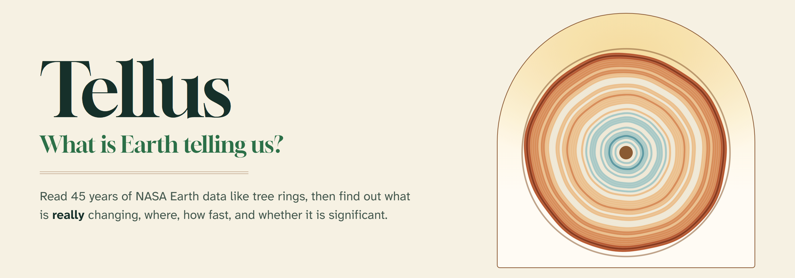
</picture>

<p align="center">
<a href="https://tellus-web.onrender.com"></a>
<a href="https://www.spaceappschallenge.org/2026/challenges/earth-system-trend-detective/"></a>
<a href="https://power.larc.nasa.gov/"></a>
<a href="#testing"></a>
<a href="LICENSE"></a>
</p>

> **Why "Tellus"?** *Tellus* is Latin for "Earth". The Romans had a goddess of the same name, and she was apparently a great listener. Our planet has been talking for 4.5 billion years, mostly in noisy data, and nobody was taking notes. So we built an app that does, then asks the data to prove it wasn't just having a bad year.

**Live app: https://tellus-web.onrender.com** · free to use, no login
<!-- DEMO LINK: add the 30-second video or 7-slide deck link here after recording -->

Tellus is our entry for the NASA Space Apps Challenge 2026, **"Be An Earth System Trend Detective!"**. The challenge asks for *"a tool that can select variables measured by Earth science missions or produced by Earth science models, visualize how they change over time, and determine what is changing, where it is changing, how much it is changing, and if these changes are what scientists call significant."* Tellus does all five, for anyone, in plain language, and then shows its working.

---

## The idea in one minute

A chart of 45 years of Earth data always slopes one way or the other. The hard question is whether that slope is a real change or just a run of unusual years. Climate records make the usual test overconfident, because warm years tend to follow warm years.

Tellus answers the question honestly:

1. **Ask a question in a sentence.** *"Is the Arctic getting warmer over the last 45 years, all year?"* Every word in the sentence is a choice: 22 places, 8 core NASA measurements, three spans of years and three seasons.
2. **Read the answer as a sentence.** *"The Arctic is getting warmer, and it has been clear since 2002."* Behind it: **+0.46 °C per decade** (95% interval +0.36 to +0.56) from NASA POWER (MERRA-2).
3. **See the story on the chart.** Four short answers (how fast, since when, steady or a step, how sure), each lighting up its part of the chart.
4. **Test it yourself: is it real, or just weather?** Switch between the naive test, a live shuffle of the real years, and Tellus's corrected test that allows for years that cluster.
5. **Go deeper in the field desk.** A global map of trends, draw your own region anywhere on Earth, compare two places, check model against satellite, and export the evidence.

<picture>
  <source media="(prefers-color-scheme: dark)" srcset="assets/readme/flow-dusk.png">
  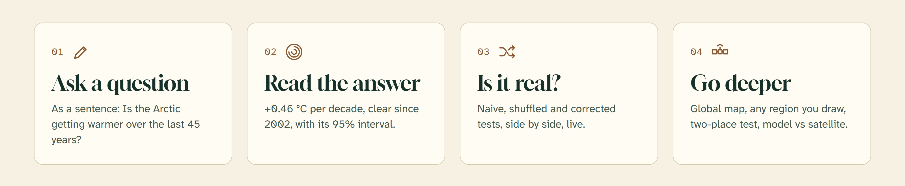
</picture>

<picture>
  <source media="(prefers-color-scheme: dark)" srcset="assets/readme/numbers-dusk.png">
  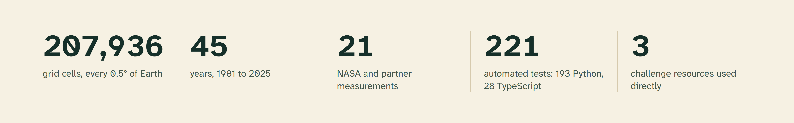
</picture>

## What you can do

### The journey (start page)
A guided path, one question per screen, designed for someone with no background in statistics.

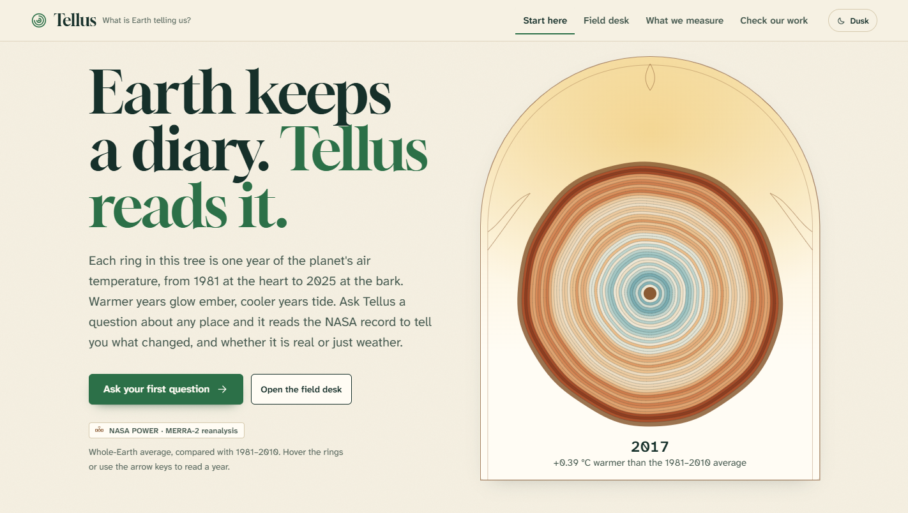

<table>
<tr>
<td width="50%">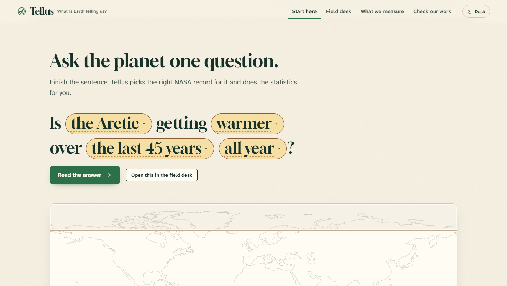<br><sub><b>Ask the planet one question.</b> Every word is a choice; the map shows the real trend, with unclear places hatched.</sub></td>
<td width="50%">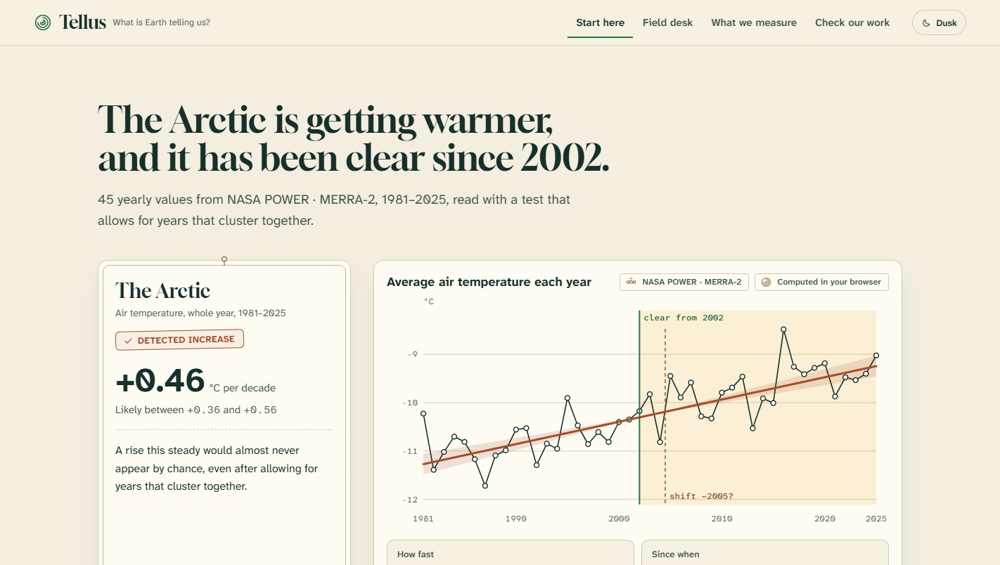<br><sub><b>The answer, as a sentence.</b> Rate per decade, 95% interval, and the year the change became clear.</sub></td>
</tr>
<tr>
<td width="50%">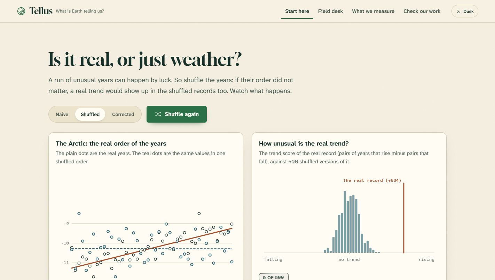<br><sub><b>Is it real, or just weather?</b> 0 of 500 shuffled records match the real Arctic trend.</sub></td>
<td width="50%">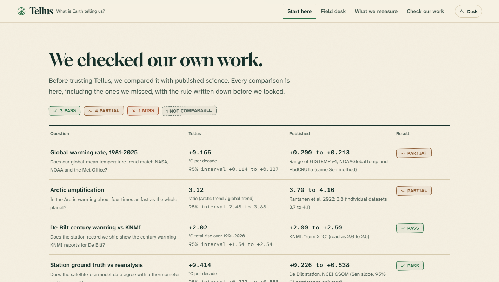<br><sub><b>We checked our own work.</b> Our numbers next to published science, with pass rules written first.</sub></td>
</tr>
</table>

- **Earth keeps a diary.** A tree-ring disc with one ring per year from 1981 to 2025, each coloured by that year's real global temperature compared with the 1981–2010 average. Point at any ring, or use the arrow keys, to read the year.
- **Ask the planet one question.** A sentence builder replaces forms and menus. Below it, a world map of the real trend for your choice, with places where the change is not statistically clear shown hatched.
- **The answer, told as a story.** A specimen-label verdict (rate per decade, 95% interval, year the trend became clear, possible shift year, independent years, adjusted p), a hand-drawn chart, and a linked four-part story panel.
- **Is it real, or just weather?** The same record read three ways: *Naive* (plain Mann-Kendall), *Shuffled* (500 random reorderings of the real years computed live, with a histogram against the real trend score) and *Corrected* (persistence-adjusted). For the Arctic, none of the 500 shuffles matches the real trend.
- **We checked our own work.** Our numbers next to published science, with the pass rule written down first.
- **Now it's your turn.** Four detective case files, two of them with guided tours that drive the app themselves, and **Ask Tellus**, the AI assistant.

### The field desk (analysis workspace)

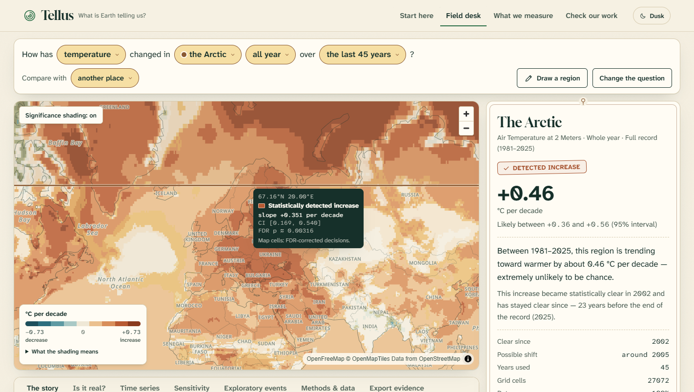

<table>
<tr>
<td width="50%">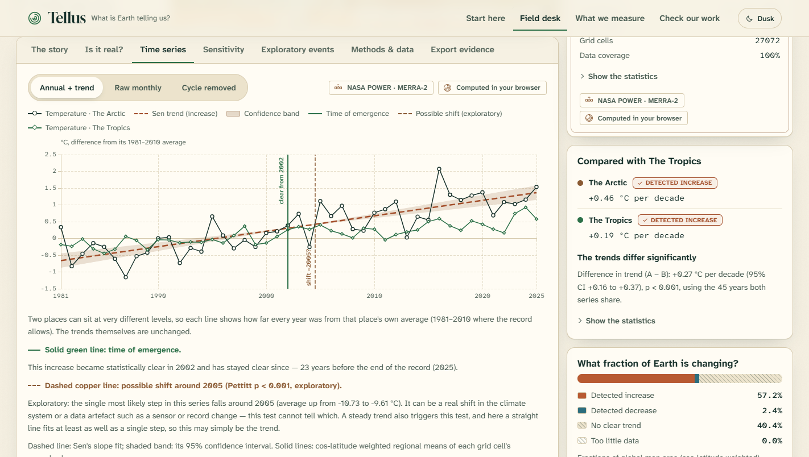<br><sub><b>Compare two places.</b> The Arctic warms +0.27 °C per decade faster than the tropics (p &lt; 0.001).</sub></td>
<td width="50%">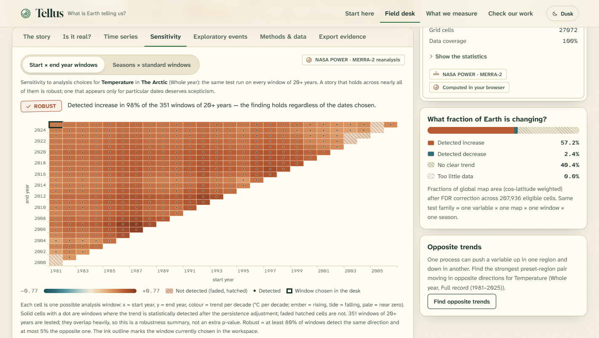<br><sub><b>Did we cherry-pick the dates?</b> The Arctic increase is detected in 98% of 351 windows.</sub></td>
</tr>
</table>

- **Global per-cell trend map** for 8 MERRA-2 variables across 207,936 grid cells, with Benjamini–Hochberg false discovery rate control across the whole map and a colour scale that shows direction and size, never "good" or "bad".
- **The question as a sentence** you can edit in place: measurement, place, season and span of years.
- **Verdict** in plain words first, statistics one click away, with linked data-source badges.
- **The story** and **Is it real?** tabs, the same components as the journey, so the two always agree.
- **Time series** with the Sen trend line, 95% band, time of emergence and possible shift, plus raw monthly values and the seasonal cycle removed.
- **Compare two places** with a formal **difference-of-trends test**. One significant and one not is not proof that they differ, so Tellus tests the difference directly. Example: the Arctic warms **+0.27 °C per decade faster** than the tropics (95% interval +0.16 to +0.37, p < 0.001).
- **Draw a region anywhere on Earth.** Tellus fetches its monthly record live from the NASA POWER API and analyses it in your browser.
- **Sensitivity:** every start × end year window, and every season × window combination, so you can see whether a trend depends on cherry-picked dates.
- **Model vs observation:** MERRA-2 rainfall against the observed GPCP V2.3 record, and NASA model variables against NASA satellite records (IMERG, AIRS, OMI and others) for the same region.
- **What fraction of Earth is changing?** Area-weighted shares of detected increase, decrease and no clear trend.
- **Opposite trends:** one click finds the strongest pair of regions moving in opposite directions for the same variable.
- **Exploratory events:** candidate anomalies and shifts, kept separate from the verdicts.
- **Export:** observations CSV, provenance JSON and a printable report.

### Ask Tellus (AI assistant)
Type a question in your own words, for example *"Is the Arctic warming faster than the tropics?"*.

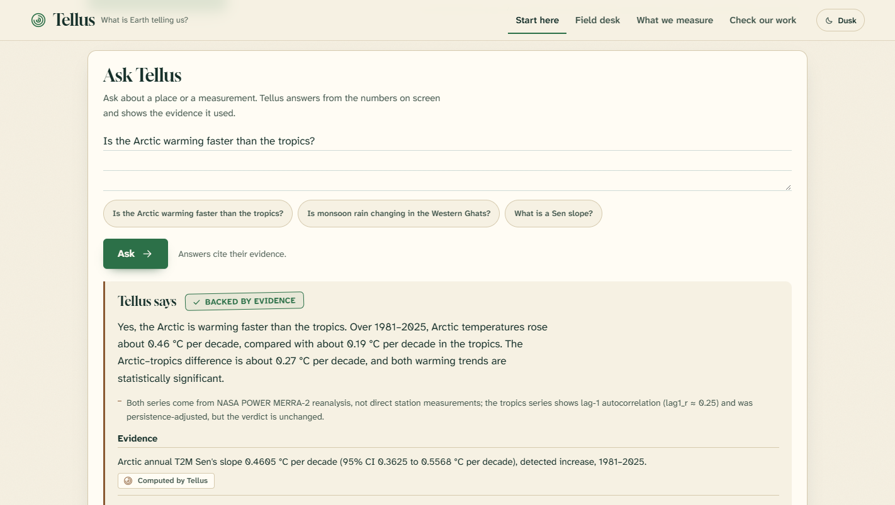

- The assistant works out the places, measurement, season and span from the question. Two named places trigger the comparison and the difference test.
- It answers **only from numbers the Tellus engine computed**, and lists that evidence under every answer.
- Every number in the reply is checked against the engine's results before it is shown.
- Method questions (*"What is a Sen slope?"*) get instant, fixed answers.
- If the AI service is unavailable, a rules-based guide (Laya) answers instead, so the app never depends on it.

### The rest of the site
- **What we measure:** a field guide to all 21 measurements, with definitions, units, what each is good for, its source, and things to keep in mind.
- **Set up your question:** the full set of choices with recommendations for what to measure in different kinds of place.
- **Check our work:** every validation case in full, with sources.
- **Day and Dusk themes** that follow your device's light or dark setting, keyboard-accessible controls, reduced-motion support and a phone layout.

<table>
<tr>
<td width="50%">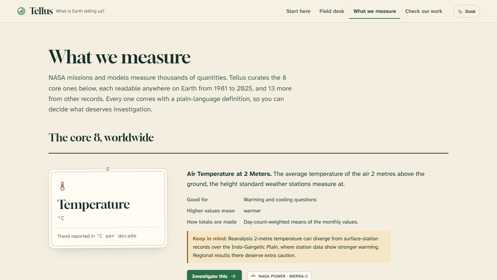<br><sub><b>What we measure.</b> A field guide to all 21 measurements.</sub></td>
<td width="50%">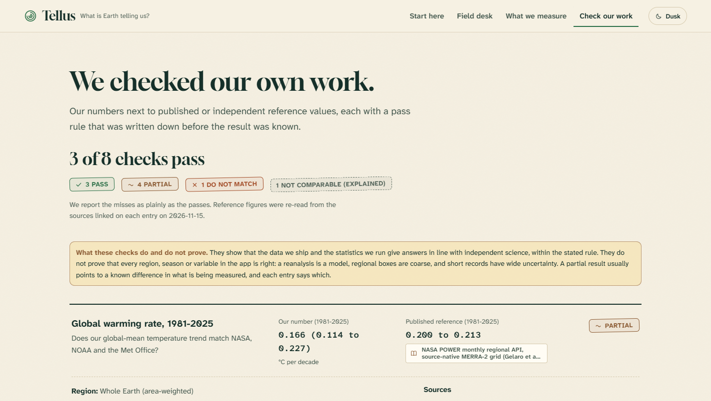<br><sub><b>Check our work.</b> 3 pass, 4 partial, 1 miss, 1 not comparable, all in full.</sub></td>
</tr>
<tr>
<td width="50%">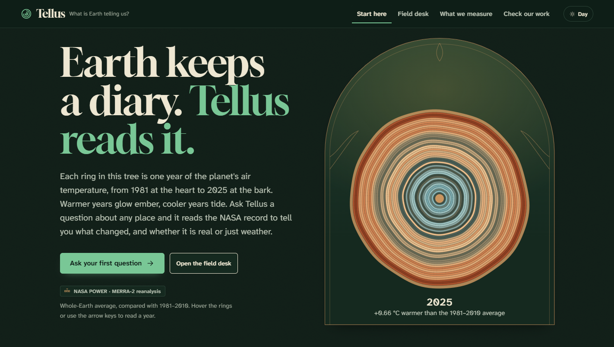<br><sub><b>Dusk.</b> Follows your device's dark setting.</sub></td>
<td width="50%">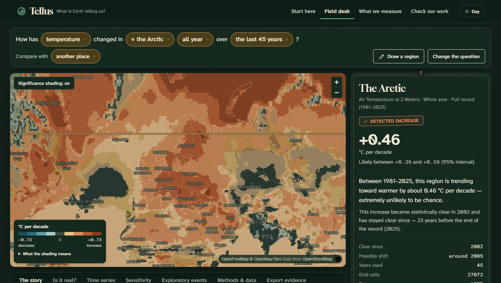<br><sub><b>The field desk at dusk.</b></sub></td>
</tr>
</table>

<p align="center">
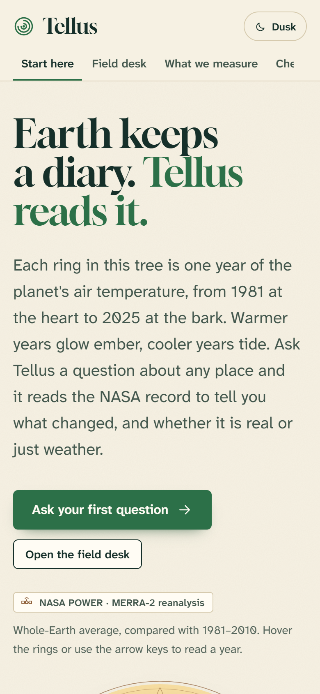&nbsp;
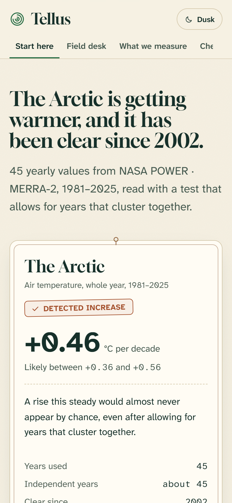&nbsp;
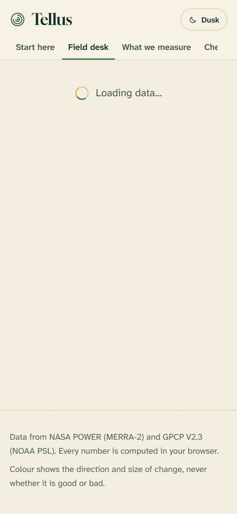
</p>

## Honest science, built in

| Principle | How Tellus does it |
|---|---|
| Neighbouring years are not independent | Mann-Kendall significance, the Sen slope interval and the OLS test are all adjusted for lag-1 persistence (AR(1) effective sample size). The naive result is shown alongside, and the map marks cells that only the naive test would call significant. |
| Robust rate of change | Sen's slope (median of all pairwise slopes) with a 95% interval, reported per decade |
| Many places means many chances of a fluke | Benjamini–Hochberg false discovery rate control across every map |
| When did it become clear? | Time of emergence: the first end year from which the trend stays significant |
| Steady trend or a single jump? | Pettitt change-point test, labelled exploratory |
| How long until a weak trend could be confirmed? | Detection horizon: an estimate of how many more years of data would be needed |
| Does it depend on the dates chosen? | Start × end window scan and season × window grid |
| Are two places really different? | Difference-of-trends test with a persistence-aware standard error |
| Missing is not zero | Years with too few months are left out, never filled in |
| Area, not pixels | Regional means and area shares weighted by cos(latitude) |
| A trend needs enough data | At least 20 valid years (18 for ocean chlorophyll only, always labelled) |
| Models can disagree with observations | Model rainfall cross-checked against observed GPCP V2.3, and model variables against NASA satellite records |
| Shown, not hidden | A one-click shuffle test lets anyone see what "significant" means |

**A finding the app makes visible:** monsoon rainfall over the Sahel (June to September, 1981–2025) rises by about **+35 mm per decade**. The naive test calls this significant (p = 0.019). But wet years cluster: Tellus counts about **15 independent years out of 45**, and the corrected test gives **p = 0.18**, not clear of ordinary weather. Tellus shows both results side by side and explains the difference.

## We checked our own work

Tellus's numbers are compared with independent datasets and published studies, each with a pass rule written down before we looked. The full ledger is in the app (*Check our work*) and in [`frontend/public/data/validation.json`](frontend/public/data/validation.json).

- **3 pass, 4 partial, 1 miss, 1 not comparable** (8 scored).
- **Station ground truth:** MERRA-2 at De Bilt warms **+0.41 °C per decade** against **+0.37** at the NOAA NCEI station: pass.
- **Century warming:** De Bilt station record **+2.0 °C over 1901–2020**, matching KNMI's published "a good 2 °C": pass.
- **Satellite rainfall:** IMERG and GPCP agree on trend direction in **76%** of regions: pass.
- **Arctic amplification:** Arctic trend / global trend = **3.1** against Rantanen et al. (2022) 3.8, the same order of effect, with the gap explained in the app.
- We report partial results and the miss in the same detail as the passes.

## Testing

- **193 Python tests:**
  - known-slope recovery
  - false-positive calibration
  - AR(1) persistence behaviour
  - outlier robustness
  - unit conversion and area weighting
  - determinism
  - the vectorised global engine against the per-series reference
  - the AI assistant's question understanding, number checking and fixed method answers
- **28 TypeScript tests** for the in-browser engine and the interface logic.
- **Python ↔ TypeScript parity:** the in-browser engine matches the Python reference on 300 series, FDR, special functions, 129 emergence, 9 window-scan, 150 difference-of-trends and 300 Pettitt cases.

## Data

All data is open. Every mission download is logged with its request URL and UTC time (`data/raw/missions/fetch_log*.jsonl`).

| Dataset | Role | Coverage | Access |
|---|---|---|---|
| **NASA POWER** monthly regional API (MERRA-2, 0.5° × 0.625°) | Core analysis: 8 variables, global per-cell maps, live fetch for drawn regions | 1981–2025, whole planet | POWER API |
| **GPM IMERG** Final monthly V07 | Observed satellite rainfall | 1998–2024 | NASA Giovanni |
| **GLDAS Noah v2.1** (runoff, evapotranspiration, soil moisture) | Second NASA land model | 2000–2025 | NASA Giovanni |
| **AIRS / Aqua** surface air temperature v7 | Satellite temperature | 2003–2025 | NASA Giovanni |
| **OMI / Aura** tropospheric NO₂ and aerosol optical depth | Air quality from space | 2005–2025 | NASA Giovanni |
| **NASA NOBM** ocean chlorophyll | Ocean productivity | 1998–2015 | NASA Giovanni |
| **NOAA OISST v2**, **NOAA CDR NDVI**, **CMORPH** | Sea-surface temperature, vegetation, second satellite rainfall record | varies, from 1981 | KNMI Climate Explorer |
| **NOAA NCEI Global Summary of the Month** | Weather-station ground truth (De Bilt) | 1901–2025 | NOAA Climate Data Online |
| **GPCP V2.3** (NOAA PSL) | Observed rainfall cross-check | 1979–2025 | NOAA PSL |

Tellus uses three of the challenge's listed resources directly: **NASA Giovanni, KNMI Climate Explorer and NOAA Climate Data Online**. Core MERRA-2 variables: air temperature, daytime maximum, nighttime minimum, precipitation, relative humidity, wind speed at 10 m, surface soil wetness and evaporation. 22 preset regions cover every continent and ocean.

## Architecture

```
pipeline/   Python: fetch -> aggregate (annual, Jun-Sep, Dec-Feb) -> statistics -> static assets
frontend/   React + TypeScript + Vite: MapLibre map, ECharts and SVG charts, in-browser statistics engine
backend/    FastAPI: Ask Tellus (question understanding, grounded answers, number checking, fallback)
```

- The website is static. All statistics for preset regions and drawn regions run in the browser.
- Global maps are precomputed with the same engine and loaded per view.
- The assistant's backend reuses the Python engine, so its numbers match the app's.
- Hosted on Render (static site plus a small Python service).

## Run it

```bash
# data pipeline (outputs are already committed as static assets; optional)
pip install -r requirements.txt
python pipeline/fetch_power.py        # 5,184 tiles, about 1.5 h, no login
python pipeline/fetch_gpcp.py
python pipeline/build_assets.py       # rebuilds frontend/public/data/*
python -m pytest tests                # 193 tests

# website
cd frontend && npm install && npm run dev

# optional AI assistant (the site works without it)
cp backend/.env.example backend/.env  # then add your OpenRouter key
uvicorn backend.app.main:app --port 8000
```

## Roadmap

Tellus is built to grow. Next on our list:

- **More measurements on the global map.** Bring the satellite records (IMERG, AIRS, OMI, GLDAS) from region series to per-cell global maps, and add MODIS vegetation and aerosol through AppEEARS, GRACE groundwater, CERES radiation and sea ice.
- **Scan a place.** One click to rank every measurement at a place by the strength of its evidence.
- **A time-lapse globe.** Watch the map change year by year on a 3D globe.
- **Seasonal Mann-Kendall** alongside the seasonal windows, and an El Niño–adjusted view.
- **Ask Tellus everywhere.** Let other AI tools query Tellus's verified engine directly (for example through an MCP server), and answer in more languages.
- **Classroom mode.** Saved investigations, shareable links and teacher-ready case files.
- **New missions.** NISAR radar and SWOT surface water from the partner-agency resources.

Results describe the analysed record. They are not forecasts.

## Use of AI disclosure

- **In the product:** Ask Tellus uses a large language model (NVIDIA Nemotron, served through OpenRouter) only to understand questions and phrase answers. Every number comes from the Tellus statistics engine and is checked before it is shown. Method questions use fixed, human-written answers. If the AI is unavailable, the rules-based guide Laya answers instead.
- **In development:** the team used an AI coding assistant (Claude Code, by Anthropic) to speed up implementation, testing and design work. The team chose the methods, data and validation, and reviewed and tested the results. The test suite above checks the statistics independently.

## References

**Data**
- NASA POWER Project, NASA Langley Research Center: https://power.larc.nasa.gov/ · MERRA-2: Gelaro, R. et al. (2017), *J. Climate* 30, 5419–5454.
- NASA GES DISC Giovanni: https://giovanni.gsfc.nasa.gov/ · GPM IMERG Final V07 (Huffman, G. J. et al.), GPM_3IMERGM: https://disc.gsfc.nasa.gov/datasets/GPM_3IMERGM_07/summary · GLDAS Noah v2.1 · AIRS v7 · OMI OMNO2d v003: https://disc.gsfc.nasa.gov/datasets/OMNO2d_003/summary · OMI aerosol (OMAERUVd) · NASA NOBM chlorophyll.
- KNMI Climate Explorer: https://climexp.knmi.nl/ · NOAA OISST v2 (Reynolds, R. W. et al. 2002, *J. Climate* 15, 1609–1625) · NOAA CDR NDVI · CMORPH.
- NOAA NCEI Global Summary of the Month via Climate Data Online: https://www.ncei.noaa.gov/
- GPCP V2.3: Adler, R. F. et al. (2018), *Atmosphere* 9(4), 138, https://doi.org/10.3390/atmos9040138 (NOAA PSL copy).
- Validation references:
  - GISTEMP v4 (Lenssen et al. 2019)
  - NOAAGlobalTemp (NOAA NCEI)
  - HadCRUT 5.0.2.0 (Morice et al. 2021)
  - Rantanen, M. et al. (2022), *Communications Earth & Environment* 3, 168
  - Krotkov, N. A. et al. (2016), *Atmos. Chem. Phys.* 16, 4605–4629
  - Menemenlis, S. et al. (2025), *Nature Climate Change* 15, 897–903
  - Acker, J. G. et al. (2009), *EARSeL eProceedings* 8(2)
  - the KNMI climate dashboard

  Full citations and links are in `validation.json`.
- Map: coastline from Natural Earth (public domain). Basemap from OpenFreeMap, built on OpenMapTiles and OpenStreetMap contributors (ODbL).

**Methods**
- Mann, H. B. (1945), *Econometrica* 13, 245–259
- Kendall, M. G. (1975), *Rank Correlation Methods*
- Sen, P. K. (1968), *JASA* 63, 1379–1389
- Gilbert, R. O. (1987), *Statistical Methods for Environmental Pollution Monitoring*
- Benjamini, Y. & Hochberg, Y. (1995), *J. R. Stat. Soc. B* 57, 289–300
- Pettitt, A. N. (1979), *Applied Statistics* 28, 126–135
- Weatherhead, E. C. et al. (1998), *J. Geophys. Res.* 103, 17149–17161
- Santer, B. D. et al. (2000), *J. Geophys. Res.* 105, 7337–7356
- Helsel, D. R. & Hirsch, R. M. (2002), *Statistical Methods in Water Resources*

**Software (all open source)**
- React, TypeScript and Vite (MIT)
- MapLibre GL JS (BSD-3-Clause)
- Apache ECharts (Apache-2.0)
- zustand (MIT)
- FastAPI, uvicorn and pydantic (MIT/BSD)
- NumPy and SciPy (BSD)
- xarray (Apache-2.0)
- netCDF4 (MIT)
- Fonts: Gloock and Atkinson Hyperlegible Next and Mono (SIL Open Font License), via Google Fonts

## License

Tellus is open source under the [MIT License](LICENSE). Third-party data and software keep their own licenses, listed above.
